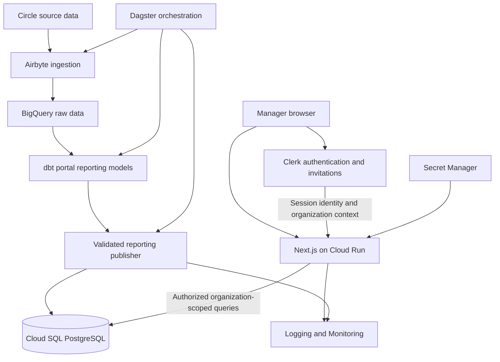

# Manager Portal Architecture

Status: Proposed architecture, not yet deployed

Date: 2026-11-12

## 1. Purpose

Provide an invite-only web portal for approximately 97 managers to view their organizations' learning reports without waiting for weekly and monthly emails.

Managers must only access data belonging to organizations in which they have an authorized membership. Initial functionality includes weekly engagement, course completions, and filters for date range, team member, and course.

The performance target is authenticated dashboard API latency below 500 ms at the 95th percentile (p95), measured from the intended users' region under an agreed representative workload. This is not a guarantee that sign-in, an entire initial page load, or every request completes within 500 ms.

## 2. Recommended Stack

| Component | Recommendation | Responsibility |
| --- | --- | --- |
| Web application | Next.js with TypeScript | Dashboard, filters, server-side authorization, and reporting queries |
| Application hosting | Google Cloud Run | Run the Next.js container |
| Identity provider | Clerk Organizations | Sign-in, invitations, organization membership, and roles |
| Reporting serving database | Cloud SQL for PostgreSQL, Enterprise edition | Serve indexed dashboard queries |
| Analytics source of truth | Existing BigQuery and dbt | Prepare canonical reporting datasets |
| Orchestration | Existing Dagster pipeline | Refresh warehouse models and publish portal data |
| Secrets | Google Secret Manager | Store server-side credentials and keys |
| Observability | Cloud Logging and Cloud Monitoring | Track availability, latency, errors, and data freshness |

Use a single Next.js application initially. A separate frontend and API service are unnecessary for the proposed scope.

Convex is not required in this design. It could replace the serving layer, but would still need organization authorization and warehouse-to-serving data publication. PostgreSQL fits the existing SQL reporting models and filter patterns directly.

## 3. System Overview



BigQuery remains authoritative for analytics. Cloud SQL contains a dashboard-ready copy, not a migration of the entire warehouse. BigQuery is not queried on the interactive dashboard request path.

Clerk authenticates managers to the application. The application connects to Cloud SQL using its own database identity. Managers never receive database credentials.

## 4. Repository Boundaries

### Existing data repository: `realpars`

- Existing ingestion, BigQuery, dbt, and Dagster code.
- New canonical portal reporting models.
- New BigQuery-to-Cloud SQL publishing job and validation checks.

### Proposed application repository: `realpars-manager-portal`

- Next.js application and Clerk integration.
- Server-only reporting query and authorization code.
- Cloud SQL schema migrations.
- Container build and application deployment configuration.
- Application tests and tenant-isolation tests.

The application repository owns the Cloud SQL schema. The data pipeline writes to that agreed schema; it does not independently alter tables. Coordinate schema versions and use backward-compatible deployment ordering where a publisher and application release cannot happen together.

No new repository or cloud resources are created by this document.

## 5. Data Model

Use stable organization, member, and course identifiers. Do not authorize or join records using display names or email addresses.

| Logical table | Grain and key fields | Ownership |
| --- | --- | --- |
| `organizations` | One organization; internal ID, unique Clerk organization ID, unique warehouse business ID, name, access status | Application administration |
| `organization_members` | One organization/member association; organization ID, member ID, display name, membership status or validity dates | Reporting publisher |
| `member_weekly_activity` | One organization/member/week; activity measures and week start date | Reporting publisher |
| `course_completions` | One organization/member/completion event; member ID, course ID, course name, completion timestamp | Reporting publisher |
| `reporting_publications` | One publication; publication ID, schema version, source cutoff, completion timestamp, row counts, status | Reporting publisher |

The completion key must match actual source semantics. If a member can complete the same course multiple times, preserve an event ID or another validated event key rather than assuming member/course is unique.

Do not duplicate facts for each manager. Managers in the same organization read the same organization-scoped facts. Otherwise, adding managers can inflate totals.

Clerk remains authoritative for user identities and organization memberships. PostgreSQL does not need copies of passwords or a second authoritative manager-membership directory. Add local profiles only when application functionality requires them.

### Initial reporting views

| View | Filters | Example measures |
| --- | --- | --- |
| Team activity | Date range and member | Weekly activity counts and active members |
| Course completions | Date range, member, and course | Completions and distinct learners |

Course completion events do not, by themselves, provide percentage progress through a course. Per-course progress would require enrollment, lesson completion, course structure, and an agreed calculation.

## 6. Existing Data Considerations

The current repository contains weekly activity and course completion models, as well as manager/business associations derived from Circle tags and a supplementary CSV roster.

Before publishing portal data:

- Validate the initial mapping from businesses to authorized managers. Tag-name heuristics and CSV display names should not become the portal's runtime authorization mechanism.
- Build portal-specific models rather than exposing email-rendering tables directly.
- Preserve identifiers that some existing BI projections omit.
- Remove manager-level fan-out from canonical reporting facts.
- Define a consistent engagement scoring formula; existing reporting paths use differing weights.
- Address the existing monthly email model's single-business filter and event-derived reporting-month logic before reusing its calculations.
- Include zero-activity members where required, rather than returning only members with facts.

These are code-inspection observations, not verification of the current deployed warehouse or live pipeline state.

## 7. Authentication and Invitations

Use Clerk Organizations with administrator-controlled onboarding:

1. An authorized administrator creates a Clerk organization.
2. The administrator records its mapping to the correct warehouse business in Cloud SQL.
3. The administrator invites a manager's email into that organization.
4. The manager accepts through Clerk's invitation flow using the verified identity required by that flow.
5. The manager signs in and accesses the organization's dashboard.

Disable public organization creation and automatic domain-based enrollment. Do not grant access solely because an email domain matches a business name.

Use basic organization Member access for read-only managers. Restrict organization administration and invitations to designated administrators. If additional roles are introduced, enforce the corresponding permissions in server-side data handlers.

Clerk Pro is recommended for MFA. Basic invitations do not automatically require the enhanced B2B add-on; verify current plan limits before launch.

## 8. Authorization and Tenant Isolation

Each reporting request must:

1. Validate the Clerk session server-side.
2. Require an active organization context from the validated token.
3. Check any applicable role or permission.
4. Resolve the Clerk organization to an enabled internal organization mapping.
5. Validate filters and execute a parameterized query scoped to that organization.
6. Return only organization-authorized records.

Never trust an unchecked organization ID submitted by the browser. Apply the same rules to dashboard cards, tables, filter options, drill-downs, and exports.

An illustrative query boundary is:

```sql
SELECT c.member_id, c.course_id, c.course_name, c.completed_at
FROM course_completions c
JOIN organizations o ON o.id = c.organization_id
WHERE o.clerk_org_id = $1
  AND o.access_status = 'enabled'
  AND c.completed_at >= $2
  AND c.completed_at < $3
ORDER BY c.completed_at DESC, c.id DESC
LIMIT $4;
```

Here, `$1` comes from validated Clerk organization context. All parameters are bound values. The example assumes the implemented schema includes these fields.

For organization switching across browser tabs, use Clerk's tab-specific token handling for background data requests rather than assuming the shared session cookie always represents the intended tab's organization.

Start with private, non-shared responses. If caching is introduced, authorize before returning cached data and include organization, filters, and reporting publication in cache keys. Never share tenant-specific responses through a public cache.

Application query scoping is the initial tenant boundary. PostgreSQL row-level security can provide defense in depth, but requires a deliberate transaction-scoped tenant-context design compatible with connection pooling. It is not enabled automatically by Clerk.

### Revocation

Clerk session claims have a validity window. Removing membership must not be assumed to invalidate every already-issued token immediately. Define the acceptable revocation delay before launch. If immediate revocation is required, implement an appropriate current-access check or local deny mechanism and measure its effect on latency.

Verify webhook signatures and make processing idempotent if webhooks are used for audit, profile synchronization, or access lifecycle integration.

## 9. Reporting Publication

Use the existing Dagster pipeline to publish after a successful dbt reporting build. Start with daily refreshes if source quotas and cost permit. Display the last successful publication and source cutoff in the portal.

For a small dataset, begin with a complete reporting snapshot rather than complex incremental synchronization:

1. Build and test canonical portal models in BigQuery.
2. Extract the related datasets from one consistent reporting cutoff.
3. Load staging tables in Cloud SQL without changing the active dataset.
4. Validate schema version, uniqueness, organization mappings, referential integrity, and counts/totals against the source.
5. Acquire a publication lock to prevent overlapping writers.
6. In one PostgreSQL transaction, update the related reporting tables from staging and record the successful publication.
7. Commit only after all required updates succeed.

For the initial small dataset, preserve live table identities and foreign keys by replacing reporting rows transactionally rather than renaming arbitrary tables. Reporting endpoints that run several queries must use one consistent database snapshot or an explicitly pinned publication, so a refresh cannot mix versions within a response.

Do not replace application-owned organization mappings during snapshot refreshes. Treat unknown warehouse organizations as an explicit validation condition, not permission to create portal access automatically.

Failed validation or publication must leave the previous successful dataset available. Use bounded retries, record failures, and alert when publication freshness exceeds the agreed threshold. Re-running a publication must not duplicate completion records.

Size the refresh using actual row counts, transaction duration, and database capacity. Introduce incremental publishing or versioned datasets only if full snapshots become too expensive or disruptive.

## 10. Performance and Deployment

### Starting configuration

- Cloud Run: request-based billing, approximately 1 vCPU and 512 MiB RAM, minimum one instance; increase memory based on measurement.
- Cloud SQL: PostgreSQL Enterprise, approximately 1 vCPU and 3.75 GB RAM, single-zone initially if the availability requirement permits.
- Locate the application and serving database in the same region, near intended users and consistent with data residency requirements.
- Keep application instances stateless. Do not depend on process memory or local files for durable application state.
- Reuse a bounded database pool per application instance.
- Cap Cloud Run scaling so aggregate application pools plus publisher and administration connections fit within the database connection budget.

Minimum Cloud Run instances reduce scale-from-zero delays but do not eliminate all cold starts during deployment, replacement, or scaling. Database sizing is provisional until query plans and representative load are tested.

### Query design

Starting index candidates:

```text
member_weekly_activity:
  (organization_id, week_start_date)
  (organization_id, member_id, week_start_date)

course_completions:
  (organization_id, completed_at)
  (organization_id, member_id, completed_at)
  (organization_id, course_id, completed_at)
```

Confirm indexes using actual query plans. Name searches must be organization-scoped and use an appropriate search index if partial matching makes normal indexes ineffective.

Bound date ranges and page sizes, paginate detail tables, and precompute expensive summaries in dbt. Avoid sequential request waterfalls when a bounded dashboard endpoint can return related data together.

### Latency validation

Measure end-to-end authenticated API latency and database execution separately. Test typical and worst-case date ranges, large organizations, filter combinations, concurrent managers, publication activity, and cold/warm requests. Track p50, p95, and p99 rather than averages alone.

Cloud Run is preferred for reduced server maintenance, not because Compute Engine cannot meet the target. An always-running Compute Engine deployment is a valid alternative if the team prefers to own VM patching, process supervision, and availability configuration.

## 11. Infrastructure Security

- Use supported Cloud SQL connectivity, such as the Cloud SQL connector or Cloud Run integration; do not expose PostgreSQL to unrestricted public access.
- Use private networking where required, and account for connector, NAT, or other networking costs if introduced.
- Separate application read access, publisher write access, and migration privileges.
- A service account's permission to connect to Cloud SQL is separate from its PostgreSQL table permissions.
- Use a restricted administrative path for organization mapping changes rather than broad write privileges in reporting endpoints.
- Store Clerk secret keys and database secrets in Secret Manager. Never expose them through browser bundles or public environment variables.
- Configure automated backups, point-in-time recovery, retention, and restore testing.
- Avoid logging session tokens, secrets, or unnecessary employee-level data.
- Rate-limit expensive endpoints and enforce bounded filters and export sizes.

Single-zone Cloud SQL is a cost-conscious starting point, not a highly available database deployment. Select regional high availability if business requirements demand automatic zonal failover. Backups are not a substitute for high availability.

## 12. Observability and Operations

Monitor and alert on:

- API latency, error rates, and availability.
- Database CPU, memory, storage, connections, and slow queries.
- Publication failures and age of the latest successful reporting snapshot.
- Authentication and authorization failures, without exposing sensitive details.
- Billing thresholds and unexpected resource growth.

Record publication IDs and safe request correlation IDs for troubleshooting. Document recovery from failed deployment, failed data publication, and database loss. Agree on recovery time and acceptable data loss before selecting the final availability configuration.

## 13. Estimated Operating Cost

Planning estimate in USD per month, excluding taxes, development, maintenance labor, and the existing data-platform baseline. Regional prices and actual usage must be verified before provisioning.

Assumptions: 97 managers, light-to-moderate traffic, approximately 10-20 GB provisioned reporting storage, daily publication, one warm Cloud Run instance, single-zone Cloud SQL, and no additional enterprise SSO connections.

| Component | Estimated monthly cost |
| --- | ---: |
| Cloud SQL compute | $55-95 |
| Database storage and backups | $3-10 |
| Cloud Run | $10-20 |
| Clerk Pro, monthly billing | $25 |
| Incremental publishing and BigQuery processing | $1-10 |
| Supporting logs, secrets, builds, image storage, and modest traffic | $3-10 |
| **Estimated total** | **$97-170** |

Use **$200/month as an initial budget allowance**, not a guaranteed maximum. The estimate assumes a small dataset and does not include a dedicated load balancer, NAT gateway, VPC connector, always-on staging database, or cloud support subscription. Additional refresh frequency or large source scans can increase data-platform costs beyond this allowance.

At the pricing reviewed during planning, Clerk includes basic invitations, 100 monthly retained organizations, and up to 20 members per organization without its enhanced B2B add-on. Reporting subjects do not need Clerk accounts unless they log in. Pro is budgeted for MFA; the free plan could reduce the estimate by $25/month if its security features and limits are sufficient. Recheck all limits and pricing before purchase.

High-availability Cloud SQL substantially increases database costs. A dedicated staging environment and enterprise SSO can also materially change the budget.

Pricing references:

- [Clerk pricing](https://clerk.com/pricing)
- [Cloud Run pricing](https://cloud.google.com/run/pricing)
- [Cloud SQL pricing](https://cloud.google.com/sql/pricing)
- [Google Cloud pricing calculator](https://cloud.google.com/products/calculator)

## 14. Delivery Plan

1. Confirm data access policies, reporting definitions, region, and freshness requirements.
2. Validate manager-to-organization mappings and create canonical dbt portal models.
3. Create the application repository, schema migrations, and deployment pipeline.
4. Provision Cloud SQL, Cloud Run, secrets, and least-privilege identities.
5. Implement and validate atomic reporting publication in Dagster.
6. Configure Clerk organizations, invitation-only access, and server-side authorization.
7. Build activity and completion views with bounded filters and pagination.
8. Test tenant isolation, report reconciliation, failed refreshes, revocation behavior, and representative load.
9. Pilot with a small set of organizations, then invite the remaining managers.

Existing email reports can continue during the pilot. Retire or change email delivery only after report parity and stakeholder acceptance.

## 15. Decisions Required Before Implementation

- User geography, deployment region, and data residency obligations.
- Actual reporting row counts, expected growth, and retention period.
- Whether access covers an entire organization or narrower manager-specific teams.
- Historical access rules when a learner changes organizations.
- Date timezone, week boundaries, and whether filters mean events during a period or status as of a date.
- Reporting definitions, including engagement scoring and repeat course completions.
- Refresh cadence and maximum acceptable data staleness.
- Membership revocation delay, MFA policy, availability, and recovery requirements.
- Whether exports or enterprise SSO are part of the initial release.

## 16. Acceptance Criteria

- Managers can accept invitations and sign in without public organization self-assignment.
- Organization A cannot retrieve organization B's records through any endpoint, filter, identifier manipulation, or cache path.
- Dashboard totals reconcile with approved dbt outputs for sampled organizations and periods.
- Successful reporting publications are complete and consistent; failed publications leave previous data accessible.
- The portal displays the last successful publication and source cutoff.
- Authenticated dashboard APIs achieve p95 below 500 ms under the agreed test conditions.
- Backup restoration and access removal behavior have been exercised.
- Costs are monitored against the initial budget, with alerts configured.
